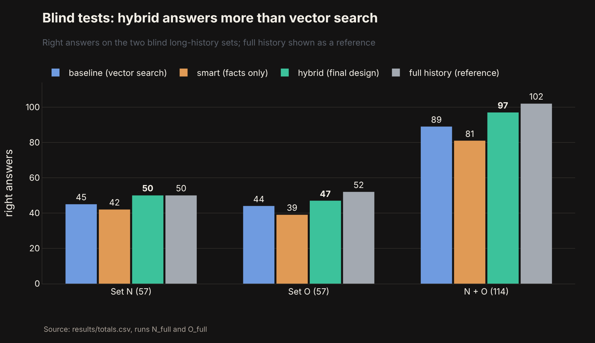
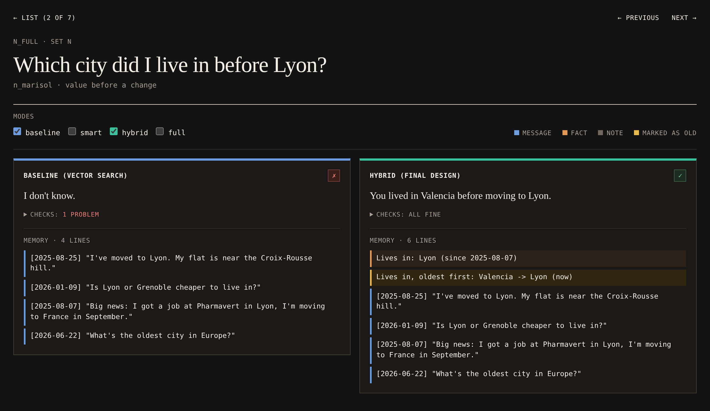

# LLM long-term memory
[](https://github.com/FrancoAseglio/llm-mem-sys/actions/workflows/ci.yml)
[](https://www.python.org/)
[](LICENSE)
[](https://github.com/astral-sh/ruff)
[](https://github.com/pgvector/pgvector)
[](https://ollama.com)
[](docker-compose.yml)

A prototype long-term memory for an LLM assistant, running fully on one machine.
It remembers what a user says across conversations, keeps track of facts that change ("I moved to Milan"),
and gives the model only what is relevant to the question.
It is measured against plain vector search over past messages, the usual way assistants remember.

## Result

On two blind test sets (114 questions about users with long, changing histories), the final
design answered more questions than vector search: 97 against 89.



The gain met the pre-registered rule on both sets but is not statistically significant
(p = 0.13).
Facts work best as annotations on the raw conversation, not as a replacement for it.
Details and limits: [docs/evaluation.md](docs/evaluation.md); the full write-up is the
[report](report/report.pdf), which checks the work against the original [proposal](report/proposal.pdf).

## How it works

- **Three layers** in Postgres: the messages, structured facts extracted from them
  (`lives_in = Milan`, `allergic_to = peanuts`), and one-sentence notes about episodes.
- **Write path:** a local model extracts facts from each message; pure rules check them (is the
  value in the message? is it about the user? is it a real change?). A new value replaces the old
  one, which is kept as history, never overwritten.
- **Read path:** facts pass a relevance gate (similarity floor, relative window, routing by kind),
  so the prompt holds only what matters. The final *hybrid* mode reads the most similar messages
  and labels the outdated ones: `"I've moved to Oslo" [outdated: Lives in: Oslo -> now Kristiansand]`.

More in [docs/design.md](docs/design.md).

## Quick start (Docker)

Needs Docker and Ollama.
Everything runs in containers except Ollama, which stays on the Mac:
Docker on macOS cannot use the GPU, and the models would take minutes per answer.

```bash
brew install ollama
brew services start ollama
ollama pull llama3.1:8b
ollama pull nomic-embed-text
make up
```

Then open http://localhost:8000: the dashboard shows every evaluation question with each mode's
memory and answer, and lets you ask stored users new questions.



The database starts with the evaluation users already loaded (`db/snapshot.sql.gz`).

- `make help` lists every command.
- `make shell` opens a shell in the project container, where every `make` command works.
- `make down` stops the containers and keeps the database; `docker compose down -v` deletes it.
- Postgres is also reachable from the Mac on port 5434 (`DB_PORT` in `.env` changes it).

## Local setup (without Docker)

Needs Python 3.12 with Poetry, Postgres 17 with pgvector, and Ollama with the two models above.

```bash
poetry install --with analysis,dashboard
cp .env.example .env
```

Set `DATABASE_URL` in `.env` to your Postgres database (for example
`postgresql://<user>@localhost:5432/memory_db`), then create the database and its tables, load
the evaluation users if you want them, and check that everything answers:

```bash
createdb memory_db
psql "postgresql://<user>@localhost:5432/memory_db" -f db/schema.sql
make snapshot-load
poetry run python scripts/smoke_test.py
```

Use the same address as in `.env` in the `psql` line, and add `-p <port>` to `createdb` if your
Postgres is not on the default port 5432. (`make db` does the same in one step, but only for the
default local server.)

## Repository

```
.
├── src/memory_system/      the memory itself
│   ├── core/               settings, database, model calls
│   ├── write/              fact extraction and update rules
│   ├── read/               relevance gate, hybrid and full modes
│   └── summaries/          episode notes and digests
├── evaluation/             test sets (scenarios/), runners, scoring, chart analysis
├── results/                every evaluation run as CSV tables, with a data dictionary
├── notebooks/              results.ipynb, the charts
├── dashboard/              local web dashboard (FastAPI)
├── scripts/                chat, score inspector, scenario list, smoke test, snapshot
├── db/                     schema.sql and the evaluation snapshot
├── docs/                   design.md and evaluation.md
├── report/
│   ├── proposal.pdf        the original plan
│   └── report.pdf          the final report
├── tests/                  unit and database tests, mirroring the packages
├── Dockerfile
├── docker-compose.yml      Postgres and the dashboard (Ollama stays on the host)
├── Makefile                every command: make help
├── pyproject.toml
├── poetry.lock
└── LICENSE
```

## Acknowledgements

Parts of the code, tests and documentation, notably the evaluation tooling, were written with the help of Claude (Anthropic), working from my design and instructions.
All experiments were run and checked locally, and the predictions for every test set were written before its run.

The detailed development documents, every set's predictions and the full history are kept at the
git tag [`docs-archive`](https://github.com/FrancoAseglio/llm-mem-sys/tree/docs-archive/docs).

## License

[MIT](LICENSE).
